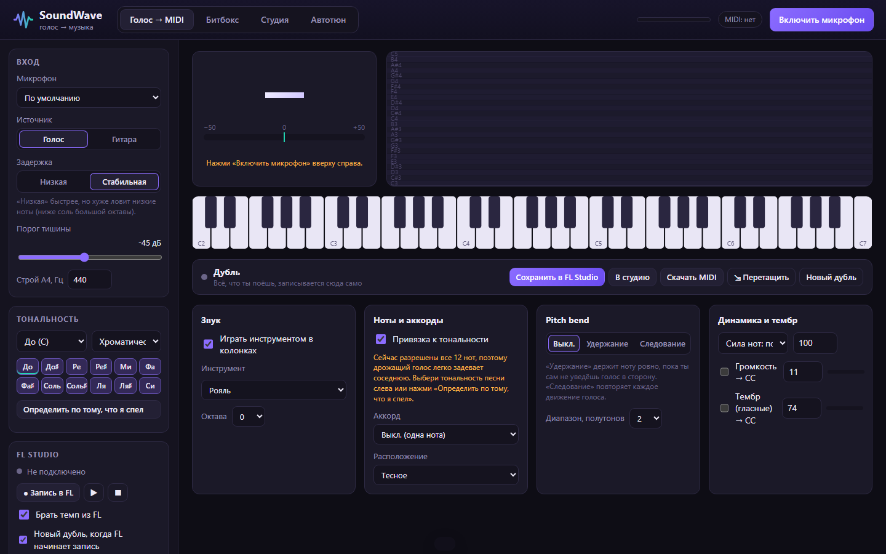

<div align="center">

# SoundWave

**Преобразование голоса и гитары в MIDI в реальном времени**

Распознавание высоты тона · Голос → MIDI · Вокальные триггеры · Многодорожечная запись · Автотюн · Интеграция с FL Studio




</div>

## Содержание

- [Назначение](#назначение)
- [Функциональные возможности](#функциональные-возможности)
- [Системные требования](#системные-требования)
- [Установка и запуск](#установка-и-запуск)
- [Порядок работы](#порядок-работы)
- [Интеграция с FL Studio](#интеграция-с-fl-studio)
- [Подключение других DAW](#подключение-других-daw)
- [Архитектура](#архитектура)
- [Структура проекта](#структура-проекта)
- [Разработка и тестирование](#разработка-и-тестирование)
- [Известные ограничения](#известные-ограничения)
- [Правовая информация](#правовая-информация)

## Назначение

SoundWave — приложение для записи музыкального материала голосом или на гитаре. Приложение принимает сигнал с микрофона, определяет высоту исполняемых нот и воспроизводит их выбранным инструментом либо передаёт в цифровую звуковую рабочую станцию (DAW) по протоколу MIDI. Записанный материал редактируется во встроенной студии и экспортируется в форматах MIDI и WAV.

Приложение работает локально в браузере на персональном компьютере. Обработка звука выполняется на устройстве пользователя, аудиоданные не передаются во внешние сервисы.

## Функциональные возможности

### Голос → MIDI

| Функция | Описание |
|---|---|
| Распознавание высоты тона | Монофоническое определение ноты в реальном времени, устойчивое к вибрато, дрожанию голоса и кратковременным провалам громкости |
| Привязка к тональности | Подтягивание исполняемых нот к выбранному ладу (9 ладов) или к произвольному набору нот |
| Автоопределение тональности | Определение тональности по исполненной мелодии (профили Крумхансла) |
| Генерация аккордов | Трезвучия и септаккорды в тональности, а также мажорные, минорные, квинтовые, sus- и септаккорды с выбором расположения |
| Pitch bend | Режимы «Удержание» (нота фиксируется до намеренного отклонения) и «Следование» (точное повторение высоты голоса) |
| Динамика и тембр | Velocity по громкости исполнения, передача огибающей громкости и тембра голоса в MIDI CC |
| Захват дублей | Автоматическая фиксация исполненного материала с сохранением в FL Studio, студию или файл MIDI |

### Вокальные триггеры

Восемь пэдов, обучаемых на звуках пользователя (вокальная перкуссия). Распознанный удар воспроизводит выбранный звук ударной установки и передаётся в DAW на канал ударных.

### Студия

- Многодорожечная запись с метрономом и отсчётом такта.
- Редактор нот (пианоролл): перемещение, изменение длительности, удаление, транспонирование, добавление нот.
- Квантизация, привязка к тональности, очистка случайных нот.
- Режимы воспроизведения дорожки: инструмент, исходный голос, голос с автотюном и их сочетания.
- Экспорт в MIDI (в том числе перетаскиванием в DAW) и WAV. Автосохранение проекта в браузере.

### Автотюн

Коррекция высоты голоса к нотам выбранной тональности в реальном времени (алгоритм TD-PSOLA) с регулировкой скорости подстройки, силы коррекции и смешивания с исходным сигналом. Для записанных дорожек коррекция применяется без изменения исходной записи.

### Инструменты

- **19 сэмплированных инструментов** (General MIDI, FluidR3): рояль, электропиано, гитары, бас, скрипка, виолончель, струнный ансамбль, хор, духовые и другие. Сэмплы загружаются однократно и кэшируются для работы без подключения к сети.
- **10 синтезированных инструментов**, работающих без подключения к сети. При недоступности сэмплов используется ближайший синтезированный аналог.

## Системные требования

| Компонент | Требование |
|---|---|
| Операционная система | Windows 10/11 |
| Браузер | Google Chrome или Microsoft Edge (поддержка Web Audio и Web MIDI) |
| Среда выполнения | Node.js 20 или новее |
| Микрофон | Любой, рекомендуется USB-микрофон или аудиоинтерфейс |
| Для работы с DAW | [loopMIDI](https://www.tobias-erichsen.de/software/loopmidi.html) (виртуальный MIDI-порт) |
| Для интеграции с FL Studio | FL Studio 20.7 или новее (проверено на FL Studio 2026) |

## Установка и запуск

**Быстрый запуск.** Запустите файл `start.bat`. При первом запуске будут установлены зависимости, затем приложение откроется в браузере.

**Запуск из командной строки:**

```bash
npm install
npm run dev
```

После запуска откройте `http://localhost:5173`, нажмите «Включить микрофон» и подтвердите доступ к микрофону.

> Для мониторинга собственного голоса используйте наушники. При воспроизведении через колонки возникает акустическая обратная связь.

## Порядок работы

1. **Настройка входа.** Выберите микрофон, тип источника (голос или гитара) и порог тишины на боковой панели.
2. **Выбор тональности.** Укажите тональность композиции или воспользуйтесь автоопределением. При разрешённых всех 12 нотах точность распознавания снижается.
3. **Исполнение.** На вкладке «Голос → MIDI» исполняемые ноты воспроизводятся выбранным инструментом и передаются в MIDI-порт.
4. **Сохранение.** Исполненный материал фиксируется в дубле. Сохраните его в FL Studio, перенесите в студию или экспортируйте в MIDI.
5. **Редактирование и экспорт.** На вкладке «Студия» выполните запись дорожек, редактирование и экспорт в MIDI или WAV.

## Интеграция с FL Studio

SoundWave передаёт ноты в FL Studio в реальном времени и управляет транспортом FL Studio. FL Studio, в свою очередь, передаёт в SoundWave текущий темп и состояние воспроизведения и записи.

### Возможности

- Запись исполняемых нот непосредственно в пианоролл выбранного канала FL Studio.
- Управление записью, воспроизведением и остановкой FL Studio из SoundWave.
- Синхронизация темпа с проектом FL Studio.
- Автоматическое начало нового дубля при старте записи в FL Studio.
- Сохранение дублей в браузер FL Studio (раздел Recorded → SoundWave).

### Настройка

Мастер настройки открывается кнопкой «Настроить связь с FL Studio» на боковой панели и выполняет подготовительные операции автоматически.

| Шаг | Действие | Выполняется |
|---|---|---|
| 1 | Запуск loopMIDI (порт «loopMIDI Port») | Автоматически |
| 2 | Установка MIDI-скрипта SoundWave в `Documents\Image-Line\FL Studio\Settings\Hardware\SoundWave` | Автоматически |
| 3 | Подключение MIDI-входа и выхода SoundWave к loopMIDI | Автоматически |
| 4 | FL Studio → Options → MIDI settings: для входа «loopMIDI Port» выбрать Controller type **SoundWave** и Port **1**; для выхода «loopMIDI Port» указать Port **1** | Однократно вручную |
| 5 | При первой записи FL Studio запросит тип записи: выбрать **Notes and automation** и отметить «Don't show this in the future» | Однократно вручную |

После настройки на боковой панели отображается статус «FL Studio на связи» с текущим темпом.

### Протокол обмена

Управляющие сообщения передаются по MIDI-каналу 16.

| Направление | Сообщение | Назначение |
|---|---|---|
| SoundWave → FL | CC 102 | Включить запись и воспроизведение |
| SoundWave → FL | CC 103 | Воспроизведение / пауза |
| SoundWave → FL | CC 104 | Остановка и снятие режима записи |
| SoundWave → FL | CC 105 | Запрос состояния |
| FL → SoundWave | CC 20 / CC 52 | Темп × 10 (старший и младший байты) |
| FL → SoundWave | CC 21 | Воспроизведение (0 / 127) |
| FL → SoundWave | CC 22 | Запись (0 / 127) |

Ноты и прочие сообщения передаются в FL Studio без изменений. Дополнительно поддерживается стандартный MIDI Clock.

## Подключение других DAW

1. Установите [loopMIDI](https://www.tobias-erichsen.de/software/loopmidi.html) и создайте виртуальный порт.
2. В SoundWave нажмите «Подключить MIDI» и выберите созданный порт в качестве выхода.
3. В DAW включите этот порт в качестве MIDI-входа и назначьте инструмент на дорожку.

## Архитектура

```
Микрофон
   │
   ▼
AudioWorklet (захват) ──► Распознавание высоты (YIN) ──► Трекер нот ──► Исполнитель
   │                                                                     │
   │                                              ┌──────────────────────┼──────────────────┐
   │                                              ▼                      ▼                  ▼
   │                                     Встроенный инструмент     MIDI-выход         Захват дублей
   │                                                                     │
   ├──► Детектор ударов ──► Классификатор (k-NN) ──► Пэды              loopMIDI ──► FL Studio
   │                                                                     ▲            │
   └──► AudioWorklet (автотюн, TD-PSOLA) ──► Наушники                    └── MIDI-вход ◄┘
```

| Компонент | Технология |
|---|---|
| Определение высоты тона | Алгоритм YIN на сигнале с двукратной децимацией |
| Автотюн | TD-PSOLA с гистерезисом выбора ноты и удержанием коррекции |
| Синтез струнных | Алгоритм Карплуса — Стронга с дробной задержкой |
| Синтез фортепиано | Аддитивный синтез с негармоничностью и двухступенчатым затуханием |
| Распознавание вокальной перкуссии | Мел-спектральные признаки и классификатор k ближайших соседей |
| Определение тональности | Корреляция с профилями Крумхансла — Кесслера |
| Интерфейс | TypeScript без фреймворков, Canvas 2D |
| Взаимодействие с ОС | Middleware dev-сервера Vite (установка скрипта FL, запуск loopMIDI, сохранение файлов) |

## Структура проекта

```
SoundWave/
├── fl/                      MIDI-скрипт для FL Studio
├── server/                  Middleware dev-сервера для взаимодействия с FL Studio и ОС
├── src/
│   ├── audio/               Аудиограф, AudioWorklet, инструменты, студия, обработка в реальном времени
│   ├── dsp/                 Высота тона, трекер нот, автотюн, гармония, вокальные триггеры
│   ├── fl/                  Протокол обмена с FL Studio
│   ├── midi/                MIDI-выход и вход, запись файлов MIDI
│   ├── state/               Настройки, проект, захват дублей, хранилище
│   ├── ui/                  Пианоролл, клавиатура, график высоты тона
│   └── main.ts              Точка входа приложения
├── tests/                   Модульные тесты
├── docs/                    Материалы документации
└── start.bat                Запуск в Windows
```

## Разработка и тестирование

| Команда | Назначение |
|---|---|
| `npm run dev` | Запуск dev-сервера |
| `npm test` | Модульные тесты |
| `npm run typecheck` | Проверка типов (клиентская и серверная части) |
| `npm run build` | Проверка типов и production-сборка |

Модульные тесты охватывают определение высоты тона, распознавание нот, устойчивость к вибрато и дрожанию голоса, автотюн, построение аккордов, определение тональности, классификацию вокальной перкуссии, формат MIDI-файлов, протокол обмена с FL Studio и захват дублей.

История изменений приведена в файле [CHANGELOG.md](CHANGELOG.md).

## Известные ограничения

- Распознавание монофоническое: одновременно определяется одна нота. Аккорды, сыгранные на гитаре, не распознаются.
- Задержка между исполнением и звучанием составляет 50–90 мс в зависимости от выбранного режима.
- Web MIDI поддерживается только в браузерах на основе Chromium. При первом подключении браузер запрашивает разрешение на доступ к MIDI.
- loopMIDI не запускается автоматически вместе с Windows. Запуск выполняется из мастера настройки или при первой команде записи в FL Studio.

## Правовая информация

Программный код разработан самостоятельно на основе опубликованных алгоритмов. Проект не связан с производителями упомянутых программных продуктов. FL Studio является товарным знаком Image-Line Software. Сэмплы инструментов предоставляются набором FluidR3 GM и загружаются из открытого репозитория [midi-js-soundfonts](https://github.com/gleitz/midi-js-soundfonts).

Репозиторий является частным и предназначен для личного использования.
